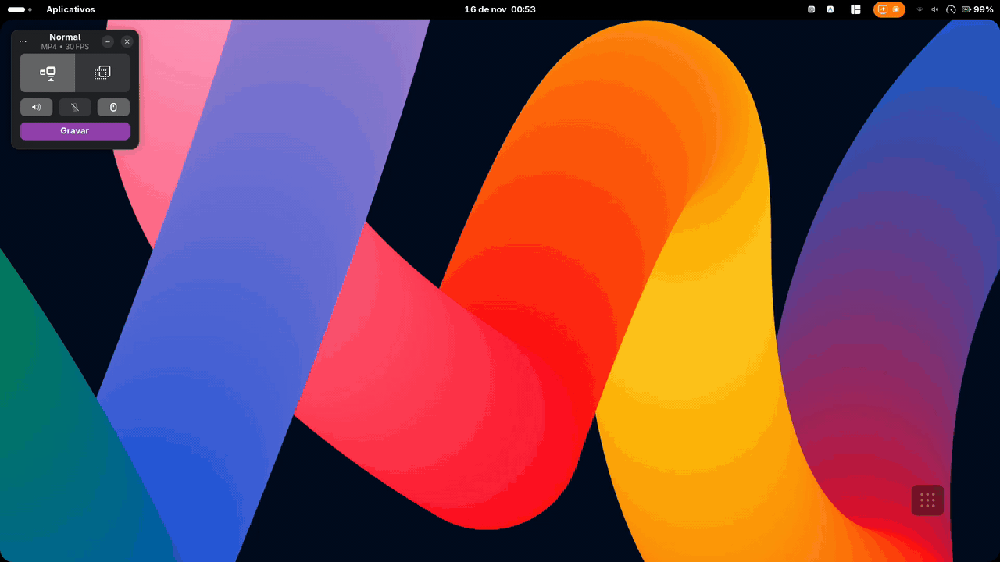

# Nexa Floating Dock

A modernized fork of [sunwxg/gnome-shell-extension-floatingDock](https://github.com/sunwxg/gnome-shell-extension-floatingDock) for GNOME Shell 51+.



## Highlights

- **Frosted Glass Blur & Clean Rounded Corners:** Uses GNOME Shell's `Shell.BlurEffect` (`radius` + `brightness`) on a decoupled background layer with per-frame hover redraws to eliminate compositor artifacts.
- **Unified Super Control Button:** Integrates the Super / App Grid button directly into the dock bar — collapsing the bar shrinks it cleanly to a single rounded pill.
- **Customizable Mouse & Touch Interactions:**
  - **Single Left Click:** Open Super / App Grid *(configurable)*
  - **Double Left Click:** Expand / Collapse the dock *(configurable, state persisted)*
  - **Right Click / Long Press (500ms):** Open the radial action menu (Lock Screen, Log Out, Suspend, Power Off, and Expand Directions), with 2-second hover tooltips and click-outside dismiss
  - **Click and Drag:** Move the dock anywhere on screen (persisted automatically; defaults to bottom-centered, 10px from the edge)
  - **Mouse Scroll Wheel:** Switch workspaces
- **Unified Accent Color & Pill Indicators:** Synchronizes the color of running app indicators (horizontal or vertical rounded pills/dots), radial menu SVG icons, and the Super icon.
- **Modern Libadwaita Preferences (`Adw.PreferencesWindow`):** Organized into **Appearance**, **Controls**, and **Behavior & Apps**, with built-in **English**, **Português (Brasil)**, and **Español** translations (auto-detected or selectable live).

## Installation from Source

```bash
make schemas
make install
```

Then log out and log back in (on Wayland) to load the extension.

## Credits

Original extension by [sunwxg](https://github.com/sunwxg/gnome-shell-extension-floatingDock).
